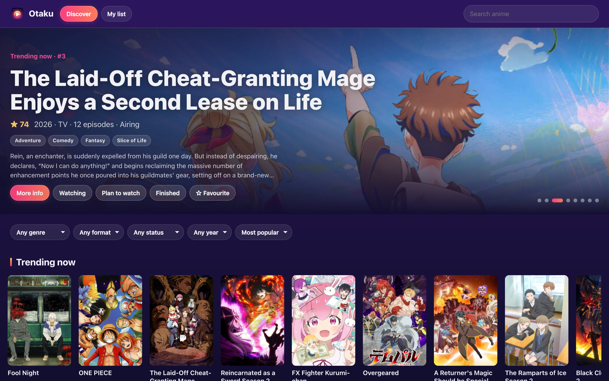
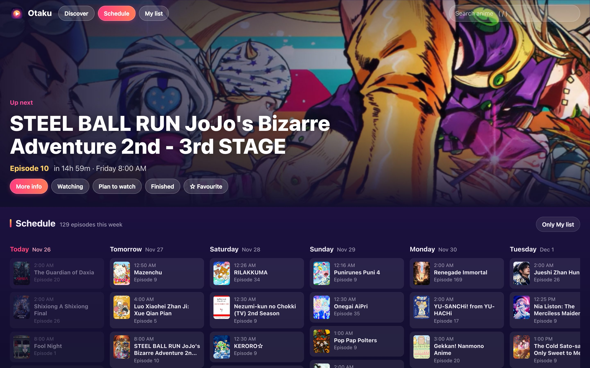
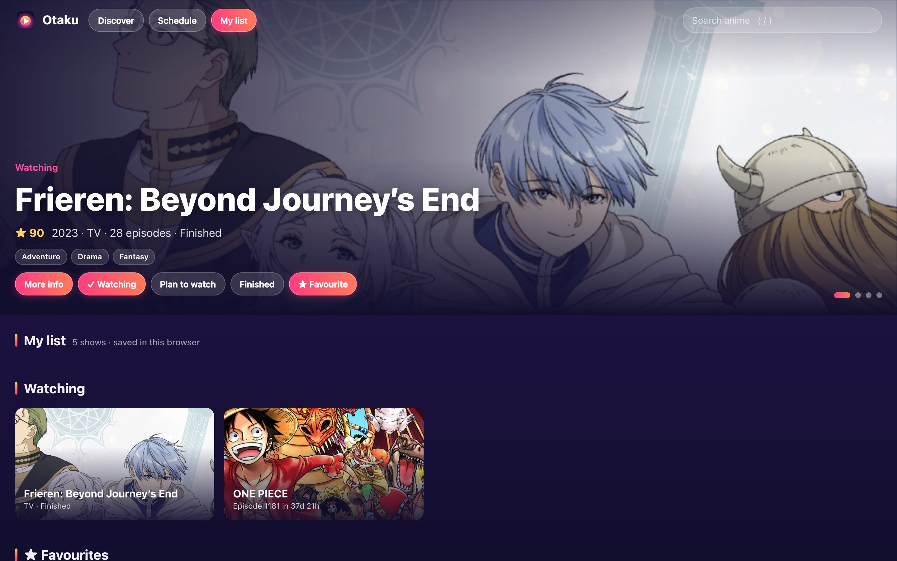
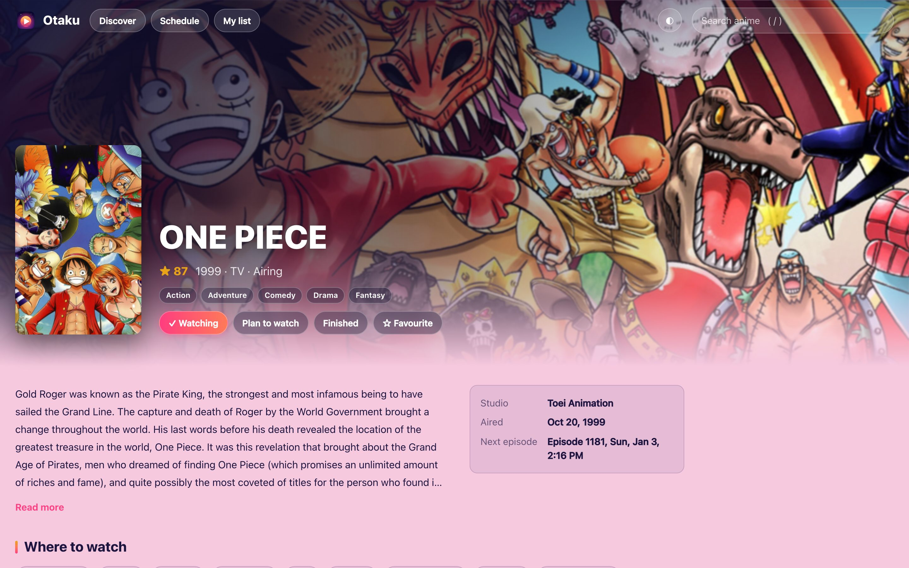
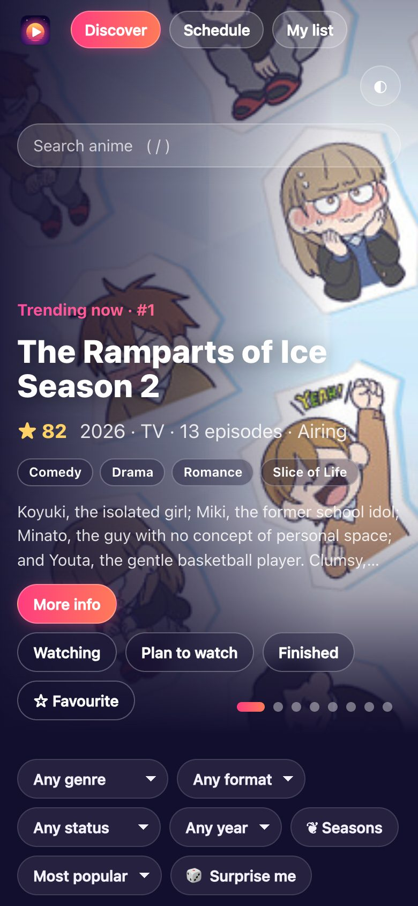

# Otaku

Find the world's favourite anime and where to watch them. A Rust server in front of AniList's GraphQL API, with a React front end.

The web version of Otaku, my SwiftUI Mac app: the same app on a second platform, with the server in Rust.



| A show's page | Season by season, all in the URL |
|---|---|
|  |  |

| This week's schedule | My list, kept in the browser |
|---|---|
|  |  |

| By day (light mode) | On a phone |
|---|---|
|  |  |

## What it does

- **Discover:** a trending carousel (8 seconds a slide, paused on hover), paged rows (airing this season, most popular, top rated, coming soon, by genre), and "Because you liked…" rows built from your favourites.
- **Search as you type** (press `/`), with filters for genre, format, status, year and sort, a season browser that steps ‹ › through seasons, and **Surprise me** for a random well-rated show. Every search is a URL, so results can be shared and the back button works.
- **Show pages:** banner, synopsis (with its source as a credit), studio and air dates, the next episode's time, the trailer, characters with their voice actors, related shows in watch order, and recommendations.
- **Where to watch:** the official streaming sites, plus what's streaming in your country when the server has a TMDB key.
- **Schedule:** this week's episodes by day, with an "Up next" countdown, a line for now, and a switch to show only your shows.
- **My list:** Watching, Plan to watch, Finished and Favourites, saved in the browser (no account needed) and kept in step across tabs, with a carousel and wide cards for what you're watching.
- The header turns see-through over each page's picture, which scrolls at half speed. Loading placeholders instead of pop-in, light, dark or auto (follows your system; the header button switches and remembers it), and a layout that works on phones.

## How it's built

```
browser ──► Rust (Axum) ──► AniList GraphQL
   │            ├──────────► TMDB watch providers (optional)
   │            ├─ cache: fresh copy, or the last good answer when AniList is down
   │            ├─ at most 3 AniList calls at a time (it allows ~90 a minute)
   │            └─ checks every filter against AniList's own names
   └─ React (Vite + TypeScript), served by the same binary
```

**Server** (`src/`)
- `anilist.rs` builds the GraphQL queries and turns AniList's nested answers into small, flat JSON. All eight home rows come from one request.
- `main.rs` holds the routes, the cache and the input checks.
- **When AniList is down:** pages keep working from the last good answer, and the site says it's showing saved data (`x-stale` header).
- **Search input** is checked against allow-lists before it reaches a query, so the server never runs anything AniList doesn't define.

**Front end** (`frontend/src/`)
- `api.ts`: types and a small fetch hook.
- `myList.ts`: the list, kept in `localStorage` through `useSyncExternalStore`.
- `ui.tsx` and `pages.tsx`: the components and pages.
- No UI library: plain CSS with colour variables for light and dark mode.

## Run it

You need Rust 1.85+ and Node 20+.

```sh
cd frontend && npm install && npm run build && cd ..
cargo run --release          # http://localhost:8080
```

While working on the front end, run `cargo run` in one terminal and `npm run dev` in `frontend/`; Vite forwards `/api` to the server. `PORT` changes the server's port, and `OTAKU_DIST` where it finds the built site. Set `TMDB_KEY` (a free [TMDB](https://www.themoviedb.org/settings/api) key) to show where each show streams in the visitor's country.

## Tests

```sh
cargo test                   # parsing, filter checks, dates, synopsis credits, TMDB search terms
cd frontend && npm test      # My list
```

`npm run smoke` (in `frontend/`) clicks through the site in Chrome (Discover → a show → My list → back → Schedule → search) and fails on any page error; run it with the server up.

The screenshots above come from `npm run screenshots`, also in `frontend/` with the server up. Both use Playwright with your installed Chrome.

## Credits

Anime data from [AniList](https://anilist.co). Streaming availability from [JustWatch](https://www.justwatch.com) via [TMDB](https://www.themoviedb.org); this product uses the TMDB API but is not endorsed or certified by TMDB. Not affiliated with AniList or any streaming service.
