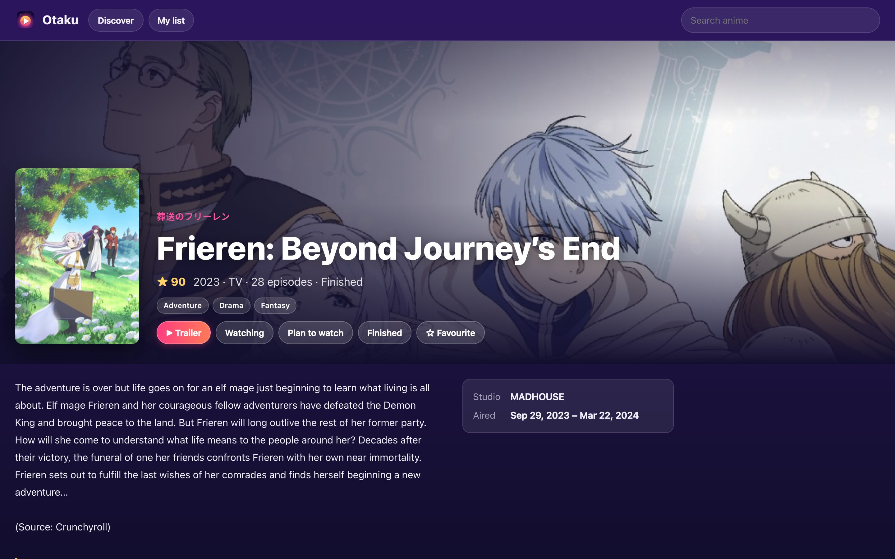
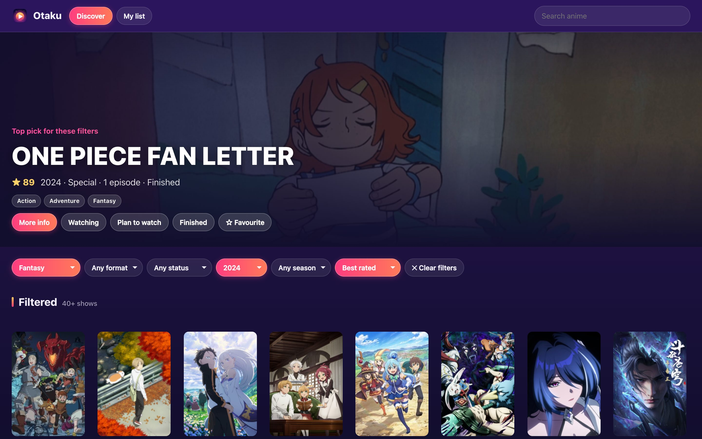

# Otaku

Find the world's favourite anime and where to watch them. A Rust server in front of AniList's GraphQL API, with a React front end.


| A show's page | Filters, all in the URL |
|---|---|
|  |  |

| By day (light mode) | On a phone |
|---|---|
|  |  |

## What it does

- **Discover:** a trending carousel (8 seconds a slide, paused on hover) and paged rows: airing this season, most popular, top rated, coming soon, by genre.
- **Search as you type**, with filters for genre, format, status, year, season and sort. Every search is a URL, so results can be shared and the back button works.
- **Show pages:** banner, synopsis, studio and air dates, the next episode's time, where to stream it, the trailer, characters with their voice actors, related shows in watch order, and recommendations.
- **My list:** Watching, Plan to watch, Finished and Favourites, saved in the browser (no account needed) and kept in step across tabs.
- Loading placeholders instead of pop-in, light and dark mode, and a layout that works on phones.

## How it's built

```
browser ──► Rust (Axum) ──► AniList GraphQL
   │            │
   │            ├─ cache: fresh copy, or the last good answer when AniList is down
   │            ├─ at most 3 AniList calls at a time (it allows ~90 a minute)
   │            └─ checks every filter against AniList's own names
   └─ React (Vite + TypeScript), served by the same binary
```

**Server** (`src/`)
- `anilist.rs` builds the GraphQL queries and turns AniList's nested answers into small, flat JSON. All eight home rows come from one request.
- `main.rs` holds the routes, the cache and the input checks.
- **When AniList is down:** pages keep working from the last good answer, and the site says it's showing saved data (`x-stale` header).
- **Search input** is checked against allow-lists before it reaches a query, so the server never runs anything AniList doesn't define.

**Front end** (`frontend/src/`)
- `api.ts`: types and a small fetch hook.
- `myList.ts`: the list, kept in `localStorage` through `useSyncExternalStore`.
- `ui.tsx` and `pages.tsx`: the components and pages.
- No UI library: plain CSS with colour variables for light and dark mode.

## Run it

You need Rust 1.85+ and Node 20+.

```sh
cd frontend && npm install && npm run build && cd ..
cargo run --release          # http://localhost:8080
```

While working on the front end, run `cargo run` in one terminal and `npm run dev` in `frontend/`; Vite forwards `/api` to the server. `PORT` changes the server's port, and `OTAKU_DIST` where it finds the built site.

## Tests

```sh
cargo test                   # parsing, filter checks, dates
cd frontend && npm test      # My list
```

The screenshots above come from `npm run screenshots` (Playwright, driving your installed Chrome) while the server is running.

## Credits

Anime data from [AniList](https://anilist.co). Not affiliated with AniList or any streaming service.
